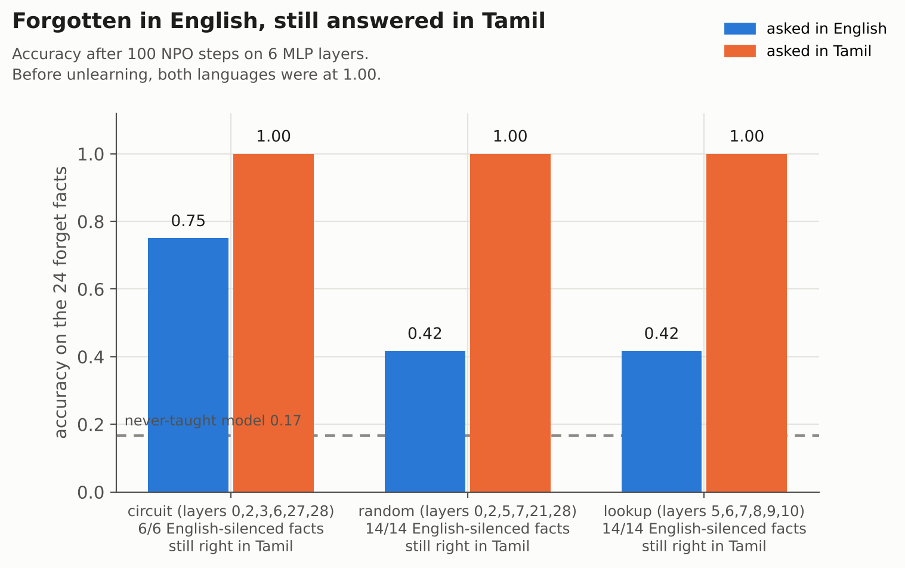

# Where Does Forgotten Knowledge Go?

**Auditing circuit-localized unlearning in Tiny Aya Global, in English and Tamil.**
Lexsi Labs AI Safety and Alignment Hackathon 2026, Track 2b (AI Safety and Correction).

[Article](ARTICLE_URL) · [Interactive Space](https://huggingface.co/spaces/vinod-anbalagan/where-forgotten-knowledge-goes) · [Models](https://huggingface.co/collections/vinod-anbalagan/where-does-forgotten-knowledge-go-models-6af482145d0cf8e6a2efd8f9) · [Data and every run log](https://huggingface.co/collections/vinod-anbalagan/where-does-forgotten-knowledge-go-data-and-logs-6af48214756c4d246ff2ef18)

We teach Tiny Aya Global 96 facts about invented people, in English and Tamil, and make it forget 24 of them with **SafeTune** NPO. The unlearning edits only 6 MLP layers, chosen by a **CircuitKIT** EAP-IG circuit, by a "lookup" prior, or at random. Then we audit where the knowledge went.



**Findings (one seed, 24 forget facts, blind-audited judge with kappa 0.96):**

1. **Forgotten in English, remembered in Tamil.** All 34 English-silenced facts were still answered correctly in Tamil, under every layer choice.
2. **Unlearned is not never-learned.** A model that never saw these people still ranks the answer in its internal (Jacobian-lens) top 10 for 83 to 93% of silenced facts. The unlearned models do so for only 0 to 21%. The answer is pushed below its prior plausibility, which leaves a detectable trace.
3. **Replaced, never refused.** Silenced answers became another item from the same list, a piece of the person's name, or a near-category word.
4. **Where you cut mattered less than what you cut.** The same facts fell under every layer choice, and the attribution-chosen circuit forgot the least (a negative result for the localization premise at n = 1).

A 3-seed pilot on real capitals adds a dose-response picture: a bf16 cast restores 22 of 24 weakly unlearned facts, but 3 of 49 at high dose.

## Pipeline

```
data/fictional_facts.jsonl  96 invented people, EN + TA
  -> scripts/teach.py        full fine-tune -> TAUGHT (all 96) and GOLD r0/r1/r2 (never saw forget set r)
  -> scripts/localize.py     CircuitKIT EAP-IG on TAUGHT -> circuit / lookup / random sets (6 MLP layers each)
  -> scripts/main_run.py     per set: SafeTune NPO on those layers only, then every audit:
                             EN/TA forgetting (+ never-trained paraphrase), retain, steering + controls,
                             J-Access (Jacobian lens) vs GOLD and decoys, whole-name rank, bf16 cast
  -> scripts/audit_fict.py   blind human audit sheet and judge agreement (kappa)
  -> scripts/make_figures.py figures/ from results.json + generations.jsonl
```

## Layout

| Path | What |
|---|---|
| `src/unlearn_audit/core.py` | model loading, generation, the language-aware judge (Tamil variants, other scripts, near misses), hidden states, steering hooks, parameter snapshots |
| `src/unlearn_audit/st_npo.py` | SafeTune `npo_unlearn` restricted to named parameters; trims logits to the answer window (`forward_fn`) so a 262k-vocabulary model fits |
| `src/unlearn_audit/jaccess.py` | J-Access (Song et al. 2026, App. A): concept tokens, readout ranks, band choice, access rates |
| `src/unlearn_audit/name_rank.py` | whole-name ranking of the true answer among the candidates of its relation |
| `scripts/` | `teach.py`, `localize.py`, `main_run.py` (main run), `pilot.py` (capitals pilot), `fit_lens.py`, `preflight.py` (17 real-model checks), `compat.py`, audit and figure scripts, `publish_hf.py` |
| `tests/` | CPU tests on a tiny random Cohere2 model. They need no download and catch silent failures: judge golden cases, SafeTune equivalence, trimmed-loss equality, J-Access, name rank, teach loss |
| `data/` | fictional facts and templates, capitals pilot set |
| `hf_launch.py` | runs any step on Hugging Face Jobs, with pinned library commits and in-job tests (`modal_app.py` is an older Modal fallback for the pilot only) |
| `figures/` | write-up figures plus `data.json` with every plotted value |

## Reproduce

**Requirements.**
- Access to the gated [`CohereLabs/tiny-aya-global`](https://huggingface.co/CohereLabs/tiny-aya-global) (CC-BY-NC-4.0).
- Python 3.12, which SafeTune needs.
- `hf auth login` and HF Jobs credit. Every GPU step ran on one A100 80 GB (`a100-large`).

**Pinned libraries**, set in `hf_launch.py`:
- CircuitKIT `e71d5e1`
- SafeTune `26f59e6`
- jlens `581d398`
- torch 2.8.0 + cu128
- transformers 5.22.1

Each job saves its full `pip_freeze.txt`.

```bash
# 1. local CPU tests (about 1 min); must end with "ALL LOCAL TESTS PASSED"
python3.12 -m venv .venv && . .venv/bin/activate
bash setup_local.sh && bash run_tests.sh

# 2. Jacobian lens on the base model (LENS-001)
python hf_launch.py fitlens --timeout 3h --extra "--repo <you>/tiny-aya-global-jlens"

# 3. teach the facts (TEACH-001)
python hf_launch.py teach --extra "--push_repo <you>/tiny-aya-fict-taught"
python hf_launch.py teach --extra "--exclude_rep 0 --push_repo <you>/tiny-aya-fict-gold-r0"   # r1, r2 likewise

# 4. CircuitKIT localization (LOC-001; about 62 min)
python hf_launch.py localize --extra "--model <you>/tiny-aya-fict-taught"

# 5. main run (RUN-005; about 50 min)
python hf_launch.py main --timeout 75m --extra "--rep 0 --sets circuit,random,lookup"

# 6. blind audit and figures (local, no GPU)
python3 scripts/audit_fict.py make  runs_hf/<main job>/<run dir>     # then label human_correct 1/0
python3 scripts/audit_fict.py score runs_hf/<main job>/<run dir>
python scripts/make_figures.py --run5 runs_hf/<main job>/<run dir> \
    --loc runs_hf/<localize job>/<run dir>/localization.json
```

**Seeds 1 and 2.** Use `--rep 1` or `--rep 2` in step 5; the GOLD models already exist.

**Capitals pilot (RUN-003, RUN-004).**
- LOW: `python hf_launch.py pilot --extra "--seed S --lens_repo <lens>"`
- MID: add `--target_drop 0.6 --max_steps 200`
- HIGH: add `--target_drop 0.9 --max_steps 200`

The pilot runs used judge v2. The judge in this repo is v3, which was tuned on the pilot's human labels and then frozen before RUN-005. A re-run of the pilot therefore scores its generations with v3. The v2-scored originals, and their human labels, are in the logs dataset.

**Provenance.** Each `results.json` stores `frozen`: the sha256 of the code and data the run used. The pre-launch hashes are recorded in each run's pre-registration. All outputs, failed attempts included, are in the [logs dataset](https://huggingface.co/datasets/vinod-anbalagan/unlearn-audit-tiny-aya-logs).

**Memory notes**, which are easy to get wrong on this model:
- Full-sequence logits at a 262k vocabulary run out of memory; `st_npo.forward_keep` keeps only the answer window.
- NPO needs non-reentrant gradient checkpointing. Without it, one step at 96 prompts needs about 280 GB of activations; with it, peak memory is 35 GB.
- CircuitKIT EAP-IG on 389-token prompts needs batch 1, and a local snapshot of a fine-tuned Cohere2 checkpoint.

## Known limits

- The main run is one seed (budget).
- The unlearned checkpoints were evaluated in memory and not saved; step 5 regenerates them.
- The J-lens was fitted on the base model, not on TAUGHT.
- The J-Access decoys are drawn across relations, which makes them a weak control; GOLD is the informative baseline.
- No general-capability benchmark was run; retain facts and capitals were the capability check.

## License

Code: MIT (see `LICENSE`). Models derived from Tiny Aya: CC-BY-NC-4.0. Data: CC-BY-4.0. CircuitKIT and SafeTune are under Lexsi Labs LSAL 1.2; jlens is Apache-2.0.
